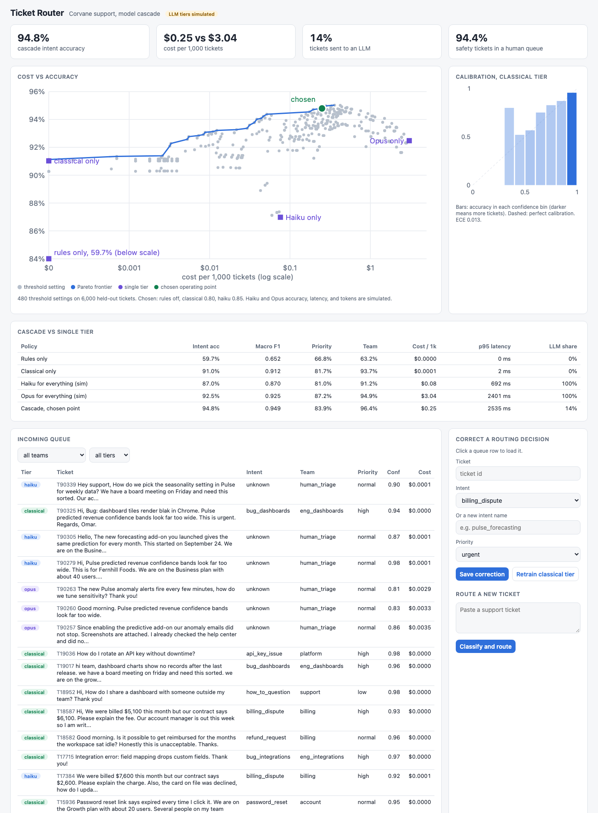

# Ticket Router

Support ticket classification and routing with a model cascade. Cheap methods go first: keyword rules, then a calibrated TF-IDF model. Only tickets those tiers are unsure about go to Claude Haiku, and only the ones Haiku is unsure about go to Claude Opus. Security and outage tickets skip every model and land in a human queue. On 6,000 held-out synthetic tickets the chosen cascade reaches 94.8% intent accuracy at $0.25 per 1,000 tickets, against 92.5% at $3.04 for sending everything to Opus. **The Haiku and Opus numbers are simulated** (see [Simulated LLM tiers](#simulated-llm-tiers)); no real API run was done.



| Policy | Intent acc | Macro F1 | Priority acc | Team acc | Cost per 1k tickets | Sent to an LLM |
|---|---|---|---|---|---|---|
| Rules only | 59.7% | 0.652 | 66.8% | 63.2% | $0.000 | 0% |
| Classical only | 91.0% | 0.912 | 81.7% | 93.7% | $0.000 | 0% |
| Haiku for everything (simulated) | 87.0% | 0.870 | 81.0% | 91.2% | $0.076 | 100% |
| Opus for everything (simulated) | 92.5% | 0.925 | 87.2% | 94.9% | $3.043 | 100% |
| **Cascade, chosen point** (LLM tiers simulated) | **94.8%** | **0.949** | 83.9% | **96.4%** | **$0.250** | 14% |

Labels carry 4% noise on purpose, so about 96% is the ceiling for any policy. Reproduce with `make eval`.

## Why

Sending every ticket to the strongest LLM is accurate and easy, and at a few million tickets a year it is also the biggest line in the support tooling budget. Most tickets are easy: "password reset link expired" does not need a frontier model. The standard fix is a cascade with calibrated confidence at each tier, so you pay for the expensive model only where it changes the answer. The hard parts are the ones this repo works through: calibration you can trust, picking thresholds from a measured cost and accuracy curve instead of by feel, hard safety rules that no model can override, a feedback loop that makes the cheap tier better over time, and noticing when a new kind of ticket appears.

## Architecture

```
ticket ─▶ 0 safety rules ──match──▶ human queue (security_oncall / incident_response), urgent, $0
            │ no match
            ▼
          1 keyword rules ── conf ≥ t_rules ──────────▶ route
            ▼
          2 TF-IDF + linear SVM, isotonic calibration ── conf ≥ t_classical ──▶ route
            ▼
          3a Claude Haiku 5.5 (structured output) ── conf ≥ t_haiku ──▶ route
            ▼
          3b Claude Opus 5.5 (structured output) ─────────▶ route   (refusal or bad output ▶ human triage)

after any tier: predicted security_concern / outage_report ▶ human queue, urgent
cost is cumulative: a ticket that ends at Opus also paid for its Haiku call

agent corrections (UI) ─▶ SQLite ─▶ retrain tier 2 ─▶ swap model in place
weekly low-confidence share ─▶ alarm ─▶ cluster unsure tickets ─▶ unfamiliar clusters for labeling
```

| Piece | File |
|---|---|
| 25 intents for Corvane, a made-up B2B analytics company, with teams and phrasings | `src/ticketrouter/taxonomy.py` |
| Seeded generator: 20,000 tickets, paraphrases, typos, 17% multi-intent, 6% Spanish, angry tone, label noise | `src/ticketrouter/data.py` |
| Tier 1 rules with confidence from score and margin; hard safety patterns | `src/ticketrouter/rules.py` |
| Tier 2 classical model and reliability bins / ECE | `src/ticketrouter/classical.py` |
| Tier 3 Claude client with JSON schema output, validator, simulated tiers | `src/ticketrouter/llm.py` |
| Price table: Haiku 5.5 $0.10/$0.50, Opus 5.5 $4/$20 per million tokens | `src/ticketrouter/pricing.py` |
| Live router, vectorized policy simulation, sweep, Pareto frontier, operating point | `src/ticketrouter/cascade.py` |
| Metrics, per-intent F1, top confusions, CI gate | `src/ticketrouter/evaluate.py` |
| Feedback store, retraining, simulated weeks of corrections | `src/ticketrouter/feedback.py` |
| Drift alarm and clustering of unfamiliar tickets | `src/ticketrouter/drift.py` |
| API, metrics, JSON logs, web UI | `src/ticketrouter/app.py`, `metrics.py`, `logs.py`, `static/index.html` |

## Results

**Data.** 20,000 tickets split into 4,000 labeled for training, 6,000 held out for evaluation, and 10,000 as the incoming pool for the feedback and drift experiments. A small labeled seed is the realistic starting point for a support team.

**Threshold sweep.** 480 settings (rules threshold x classical threshold x Haiku threshold or skip). The frontier is in the chart above. The operating point rule: the best accuracy a budget of $0.50 per 1,000 tickets can buy, then the cheapest frontier point within 0.25 points of it. That picks `rules off, classical 0.80, haiku 0.85`.

| Tier at the chosen point | Share of tickets | Accuracy on its share |
|---|---|---|
| Safety rule | 3.4% | 97.1% |
| Classical | 82.4% | 95.2% |
| Haiku (simulated) | 6.4% | 90.9% |
| Opus (simulated) | 7.7% | 93.3% |

Findings worth stating plainly:
- The cascade beats Opus for everything because the calibrated classical tier is very accurate on the tickets it is confident about, and the LLMs only see the hard ones. That depends on the simulated LLM accuracy settings, so treat it as a hypothesis to confirm with a real run.
- The keyword rules tier never makes the frontier. A calibrated model trained on 4,000 tickets is more accurate than the rules at every confidence level. The rules still earn their place as the safety layer: 69% of security and outage tickets are caught by a regex in under a millisecond, and 94.4% end in a human queue once model predictions are added. False alarms: 0.13% of all tickets.
- Calibration: expected calibration error of the classical tier is 0.013 on held-out data (isotonic regression over a linear SVM). Without good calibration a single threshold per tier does not work.
- Latency: mean 243 ms per ticket for the cascade against about 2 seconds for Opus everywhere (simulated), but p95 is similar because the slowest tickets go through both Haiku and Opus.
- Top confusions are the pairs a human would also mix up: password_reset vs account_locked, onboarding_help vs how_to_question, sso_setup vs password_reset, billing_dispute vs payment_failed. The full list with examples is in `reports/eval.json` after `make eval`.

**Feedback loop** (`make feedback-sim`). Start the classical tier on 1,000 labeled tickets. Each simulated week, 1,250 tickets go through the cascade; agents correct 70% of the misroutes and confirm 30% of the right answers; the tier retrains.

| Week | Labeled examples | Classical acc | Cascade acc | Cost per 1k | Sent to an LLM |
|---|---|---|---|---|---|
| 0 | 1,000 | 86.8% | 94.1% | $0.455 | 26% |
| 1 | 1,416 | 90.2% | 94.5% | $0.395 | 23% |
| 2 | 1,812 | 90.5% | 94.7% | $0.329 | 19% |
| 4 | 2,591 | 90.4% | 94.9% | $0.312 | 17% |
| 8 | 4,179 | 91.5% | 94.9% | $0.292 | 17% |

Most of the gain is in the first two weeks. Corrections over-sample hard tickets, so calibration error drifts up from 0.029 to about 0.045; at real scale I would recalibrate on a small random audit sample rather than on corrections.

**Drift** (`make drift`). A new product, Corvane Pulse, launches in week 7 and grows to 20% of tickets. The share of tickets with classical confidence under 0.5 sits at 0.8% for weeks 0 to 6, then jumps to 4.6% in week 7 against an alarm limit of 2.0% (baseline plus 3 binomial standard errors). The unsure tickets from week 7 on are clustered with k-means; clusters whose top terms are rare in the training data are surfaced. All five surfaced clusters are Pulse tickets (82% to 100% pure), with terms like `forecasts`, `seasonality`, `anomaly`, `bands`. An agent can label one in the UI with a new intent name; the class enters the model once it has 3 examples.

## Simulated LLM tiers

Nothing here called the Claude API. By default the Haiku and Opus tiers are `SimulatedLLM` instances (`src/ticketrouter/llm.py`) so the economics can be studied for free and the CI gate is deterministic:

| Setting | Haiku 5.5 (sim) | Opus 5.5 (sim) |
|---|---|---|
| Accuracy on the easiest ticket / hardest ticket | 97% / 74% | 99% / 90% |
| Priority accuracy | 84% | 90% |
| Self-reported confidence when right / wrong | 0.72 to 0.99 / 0.45 to 0.90 | 0.80 to 0.99 / 0.50 to 0.85 |
| Latency | 320 ms + 4 ms per output token | 1,100 ms + 14 ms per output token |
| Tokens per call | system prompt and schema (about 395) + ticket length / 4 in, 45 to 90 out | same |

Each generated ticket has a difficulty score (subtle phrasing, multiple intents, Spanish, typos, very short), and the simulated accuracy falls linearly with it. Every value is a `SimConfig` field, so you can rerun the sweep with your own assumptions. For free text typed into the UI there is no ground truth, so the simulated tiers return the classical model's best guess with a simulated confidence: that shows routing, cost, and latency, not LLM quality.

The real tier is `ClaudeTier`. It calls `client.messages.create` with `output_config={"effort": "low", "format": {"type": "json_schema", "schema": OUTPUT_SCHEMA}}`, validates the reply (intent, priority, team, confidence 0 to 1, short reason), treats a `refusal` stop reason or an off-schema reply as "send to a human", and reads token usage from the response for cost. The `anthropic` package is imported only when a real client is built. To route live tickets with real models:

```bash
uv sync --python 3.12 --extra claude
export ANTHROPIC_API_KEY=...   # from your environment, never committed
TICKETROUTER_LLM=claude make run
```

The evaluation and the CI gate always use the simulated tiers.

## How to run

```bash
cd ticket-router
uv sync --python 3.12
make test            # 83 tests
make run             # http://127.0.0.1:8836 , about 45 s to train and sweep on 20,000 tickets
make eval            # comparison table, operating point, writes reports/eval.json
make gate            # the CI check: exits 1 if the operating point fails
make drift           # weekly alarm and surfaced clusters
make feedback-sim    # weeks of corrections and retraining
```

Set `TICKETROUTER_TICKETS=4000` for a faster start while developing.

API:

```bash
curl -s localhost:8836/api/classify -H 'content-type: application/json' \
  -d '{"text":"The SAML metadata URL returns 404 during SSO configuration"}'
curl -s 'localhost:8836/api/queue?team=billing&limit=5'
curl -s localhost:8836/api/feedback -H 'content-type: application/json' \
  -d '{"ticket_id":"N00001","intent":"sso_setup","priority":"normal","agent":"dana"}'
curl -s -X POST localhost:8836/api/retrain
curl -s 'localhost:8836/api/eval?points=false'
curl -s localhost:8836/api/drift
curl -s localhost:8836/healthz
curl -s localhost:8836/metrics
```

| Endpoint | What it does |
|---|---|
| `POST /api/classify` | Route one ticket. Returns tier used, intent, priority, team, confidence, cost, reason, and the full path through the tiers. |
| `GET /api/queue` | Routed tickets, filterable by `team` and `tier`, with counts. |
| `GET /api/tickets/{id}` | One ticket and its decision. |
| `POST /api/feedback` / `GET /api/feedback` | Store or list agent corrections (known intent, or a new snake_case intent). |
| `POST /api/retrain` | Retrain the classical tier on training data plus corrections, swap it in, report held-out accuracy before and after. |
| `GET /api/eval` | Single-tier baselines, sweep points, frontier, operating point, calibration, per-intent F1, confusions. |
| `GET /api/drift` | Weekly low-confidence share, alarm, and surfaced clusters. |
| `GET /healthz`, `GET /metrics` | Health and Prometheus metrics (tickets per tier, spend per tier, safety routes, corrections, retrains, route latency histogram). |

Logs are one JSON object per line on stdout: every request, every routing decision (tier, intent, team, confidence, cost), every correction and retrain.

## Tests

83 tests, about 60 seconds: `uv run pytest -q`.

| File | Tests | What they check |
|---|---|---|
| `test_rules.py` | 8 | Rule confidence and margin, no-match behavior, safety patterns fire on security and outage text (English and Spanish) and not on routine tickets, urgency bumps priority |
| `test_classical.py` | 7 | Training on all intents, valid probabilities, accuracy, ECE under 0.06, confident predictions more accurate, reliability bin math, tiny classes |
| `test_cascade.py` | 16 | Each tier accepts or escalates at its threshold, skipping Haiku, turning rules off, bad output and refusals, safety rule skips every model, post-model safety override, cumulative cost per tier, batch simulation matches the live router ticket for ticket |
| `test_pareto.py` | 6 | Frontier on a known example, no frontier point is dominated, operating point budget and slack, over-budget fallback, CI gate pass and fail |
| `test_llm.py` | 17 | Schema validation (bad enums, ranges, missing and extra fields), the Claude request shape with a fake client, invalid JSON, refusal, token cost, pricing, simulated tiers are deterministic and hit their configured accuracy |
| `test_feedback.py` | 4 | SQLite store, latest correction wins, new intents wait for 3 examples, a new intent enters after corrections, simulated weeks improve the classical tier |
| `test_drift.py` | 5 | Alarm rule, no alarms before launch, detection in the launch week or the next, surfaced cluster is the new intent, novelty scoring |
| `test_data.py` | 6 | Seeding, shares of Spanish, multi-intent, and noise, safety labeling policy, partition, drift stream |
| `test_evaluate.py` | 3 | Report structure, cascade beats cheap baselines at under a third of Opus cost, table marks simulated rows |
| `test_api.py` | 11 | Every endpoint end to end, validation errors, duplicate ids, queue filters, feedback then retrain, and the service running with a fake Claude client |

## DevOps

- `.github/workflows/ci.yml`: ruff check and format, pytest, a **cascade gate** job that runs the full 20,000-ticket evaluation and fails if the chosen operating point drops more than 1 point below Opus-for-everything accuracy or costs more than $0.50 per 1,000 tickets (results go to the job summary and an artifact), and a Docker build with a container smoke test.
- `Dockerfile`: multi-stage uv build, slim runtime, non-root user, `/app/data` created and owned by that user for the feedback database, HEALTHCHECK on `/healthz`.
- Docker is not installed on the machine this was built on, so the image is built and smoke tested only in CI. Everything runs without Docker through `uv run`.

## Production notes

- Calibrate on a random audit sample, not on corrections. Corrections over-sample hard tickets and calibration drifts, as the feedback table shows.
- Run the real LLM tiers on a few thousand labeled tickets before trusting the frontier. The simulated accuracy settings decide where the operating point lands; a real run replaces `SimConfig` with measured numbers and the same sweep code picks new thresholds.
- Use the Message Batches API for anything not time sensitive, such as backfills and nightly reclassification, at half price, and cache the system prompt once it is long enough to qualify.
- Keep the safety rules owned by the security and incident teams, with their own tests and change review. They are the one part that must not be tuned for cost.
- Retrain behind a shadow deployment: score the new classical model on live traffic next to the current one and promote only if held-out accuracy and calibration hold. Here the swap is immediate.
- Feed drift clusters into the labeling queue as a task with an owner, and add the new intent to the taxonomy and the LLM system prompt in the same change.

## License

MIT. See [LICENSE](LICENSE).
